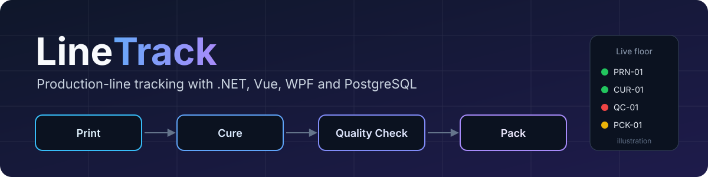
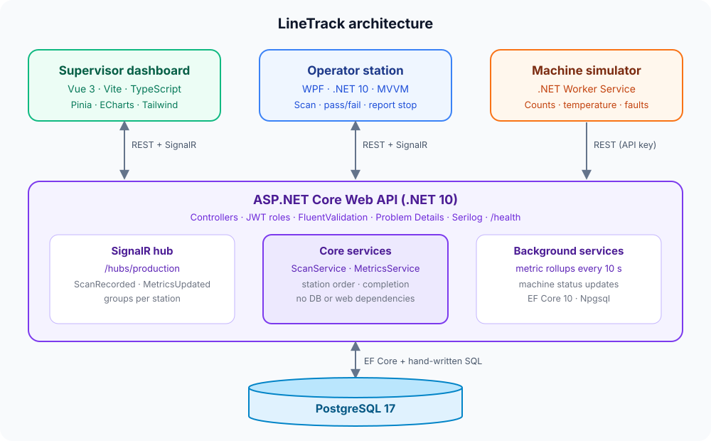
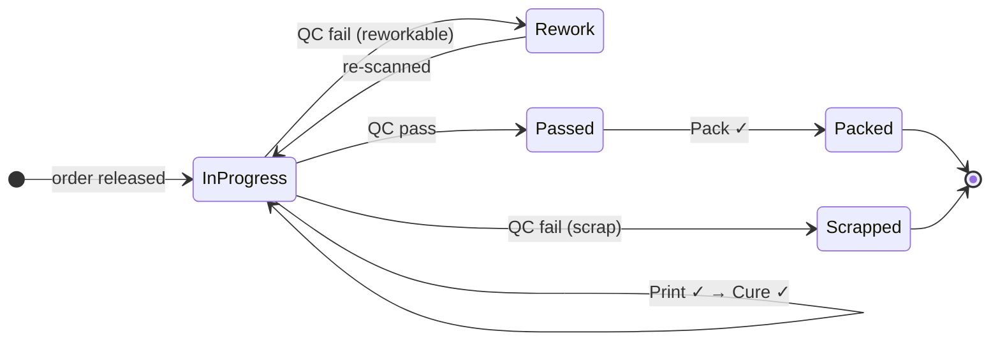
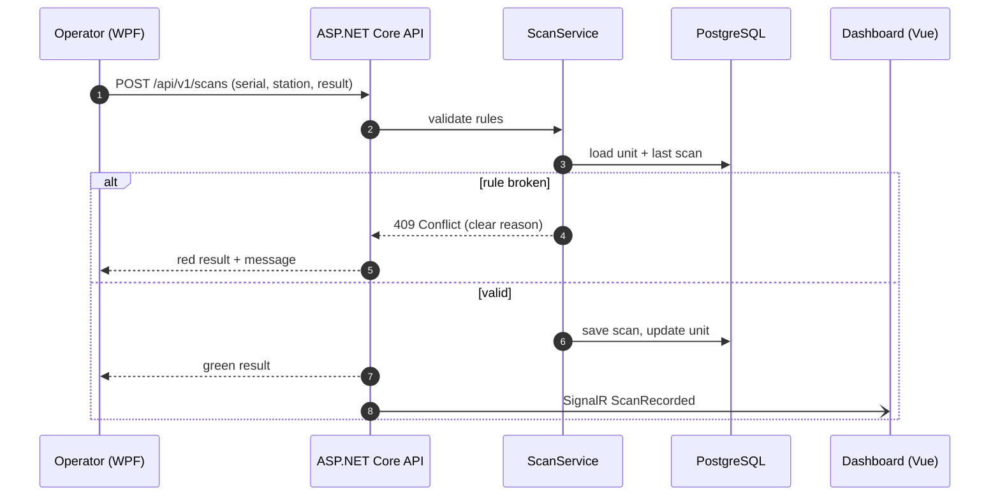
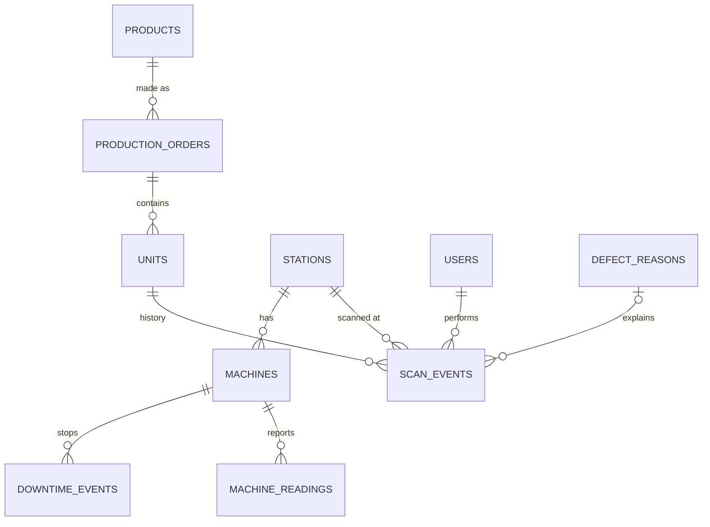

<p align="center">
  
</p>

<p align="center">
  
  
  
  
  
  
  
  
</p>

<p align="center">
  <b>Track every phone case through the factory line, from print to pack, in real time.</b>
</p>

---

> **Status: in progress.** I'm building LineTrack step by step and updating this README as each part works. See the [roadmap](#roadmap) and the [daily progress log](docs/progress.md).

## What it is

LineTrack is a small manufacturing tracker. Phone cases move through four stations (**Print → Cure → Quality Check → Pack**). Every scan, defect and machine stop is recorded, and supervisors see live production metrics on a dashboard.

I'm building it to learn .NET properly by making something real. It isn't meant to replace a full MES (Manufacturing Execution System). It's a focused, working system I can explain line by line.

## Features

| | Feature | What it does |
| --- | --- | --- |
| 📦 | **Production orders** | Create an order, release it, and get one unit per item with a unique serial (`LT-2026-000123`) and a QR code |
| 🔁 | **Station sequence rules** | The API refuses a scan that skips or repeats a station |
| ✅ | **Quality check** | Pass, or fail with a defect reason (misprint, scratch, bubble…) → Scrapped or Rework |
| ⏸️ | **Downtime tracking** | Operators or machines open a stop with a reason and close it later |
| 🔎 | **Traceability** | Search any serial and see its full history: who, which station, when and the outcome |
| 📈 | **Live dashboard** | Units per hour, defect rate, open stops and order progress, pushed live over SignalR |
| 🤖 | **Machine simulator** | A worker service acting as printers and ovens, streaming counts, temperature and faults |
| 🔐 | **Roles** | Operator, Supervisor and Admin with JWT sign-in |

## Architecture

<p align="center">
  
</p>

Three clients talk to one API. The API owns every business rule and is the only part that touches the database. The rules live in **Core** services with no database or web dependencies, so they're easy to unit-test.

### How a unit moves through the line



### What happens on a scan



### Data model



## Tech stack

| Layer | Technologies |
| --- | --- |
| **Backend** | C#, .NET 10, ASP.NET Core Web API (controllers), EF Core 10 + Npgsql, SignalR, BackgroundService, FluentValidation, JWT + BCrypt, Serilog, Health Checks, Scalar API docs, QRCoder |
| **Database** | PostgreSQL 17 with indexes and hand-written reporting queries |
| **Dashboard** | Vue 3 (`<script setup>`), TypeScript, Vite, Vue Router, Pinia, Axios, @microsoft/signalr, Tailwind CSS, Apache ECharts |
| **Operator app** | WPF on .NET 10, CommunityToolkit.Mvvm, Microsoft.Extensions.Hosting + DI, SignalR client |
| **Testing** | xUnit + Shouldly, WebApplicationFactory + Testcontainers, Vitest + Vue Test Utils |
| **DevOps** | Git, GitHub Actions, Docker + Docker Compose, GitHub Container Registry, Kubernetes (kind) |
| **Quality** | .NET analyzers, `dotnet format`, ESLint + Prettier, AI code review on pull requests |

## Project structure

```text
linetrack/
├─ LineTrack.slnx
├─ Directory.Build.props        # nullable on, warnings as errors
├─ docker-compose.yml
├─ src/
│  ├─ LineTrack.Core/            # entities, rules, ScanService, MetricsService
│  ├─ LineTrack.Infrastructure/  # EF Core DbContext, migrations, SQL queries
│  ├─ LineTrack.Api/             # controllers, SignalR hub, auth, background jobs
│  ├─ LineTrack.Simulator/       # worker service acting as factory machines
│  └─ LineTrack.OperatorStation/ # WPF operator app (MVVM)
├─ tests/
│  ├─ LineTrack.Core.Tests/
│  ├─ LineTrack.Api.IntegrationTests/
│  └─ LineTrack.OperatorStation.Tests/
├─ web/                         # Vue 3 + Vite dashboard
├─ k8s/                         # Kubernetes manifests
├─ docs/                        # diagrams, screenshots, progress log, AI-usage log
└─ .github/workflows/ci.yml
```

Core depends on nothing. Infrastructure and Api depend on Core, never the other way round.

## Roadmap

**Week 1: C# foundations, API and database**
- [ ] Solution structure, Core entities, EF Core + PostgreSQL in Docker, seed data
- [ ] JWT sign-in with Operator, Supervisor and Admin roles
- [ ] Orders and units endpoints, release + serial generation
- [ ] `ScanService` with all station rules + unit tests
- [ ] API docs with Scalar

**Week 2: Dashboard and real time**
- [ ] Vue dashboard: login, orders, traceability timeline
- [ ] SignalR hub + live floor page
- [ ] Hand-written SQL reports + charts
- [ ] Integration tests with Testcontainers

**Week 3: Equipment and WPF**
- [ ] Machine simulator with faults and retry/back-off
- [ ] Downtime tracking and live metrics
- [ ] WPF operator app: scan, pass/fail, report a stop

**Week 4: DevOps and polish**
- [ ] Dockerfiles + one-command `docker compose up`
- [ ] GitHub Actions: build, test, lint, AI review, image push
- [ ] Kubernetes deployment on kind
- [ ] Screenshots, demo GIF and design notes

## Running it

Setup steps will be added here as each part works. The goal is one command, `docker compose up`, to start the database, API, simulator and dashboard with sample data.

## How I use AI

I use AI coding tools while building LineTrack, and I review everything before it goes in. I'm keeping a short log of suggestions I accepted, changed or rejected, and why, in [`docs/ai-usage-log.md`](docs/ai-usage-log.md).

## Author

**Asad Ishaq**, Full Stack Developer · [Portfolio](https://axadishaq.web.app) · [GitHub](https://github.com/axadishaq)
